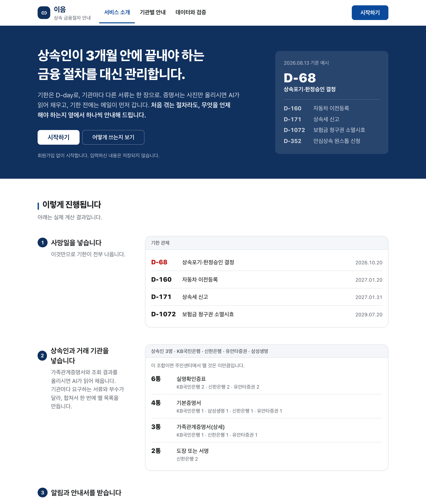
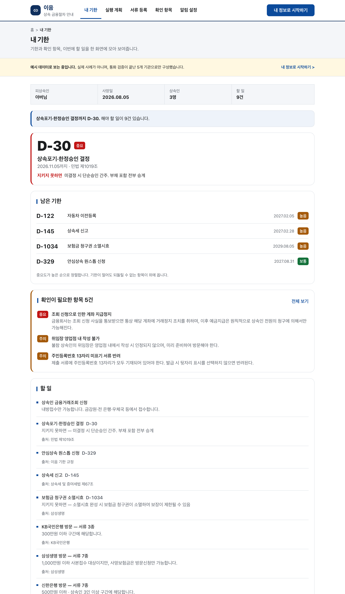
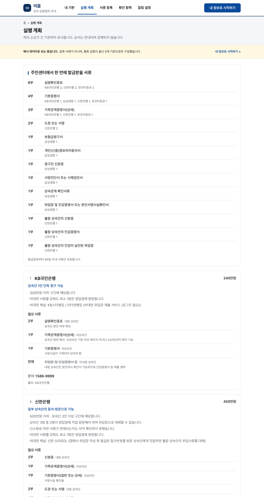
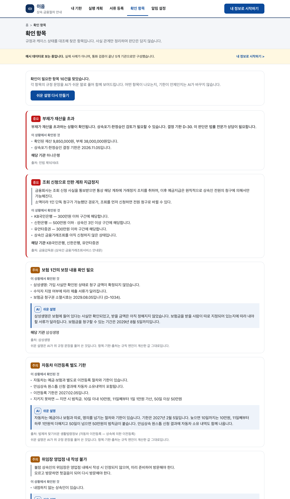
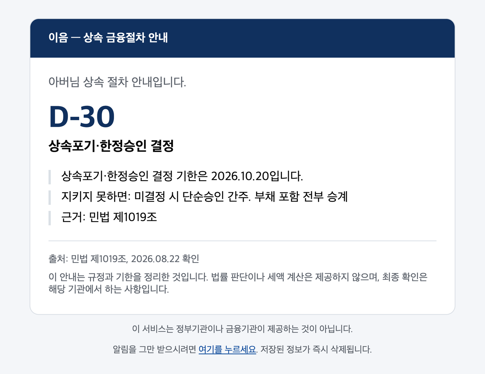
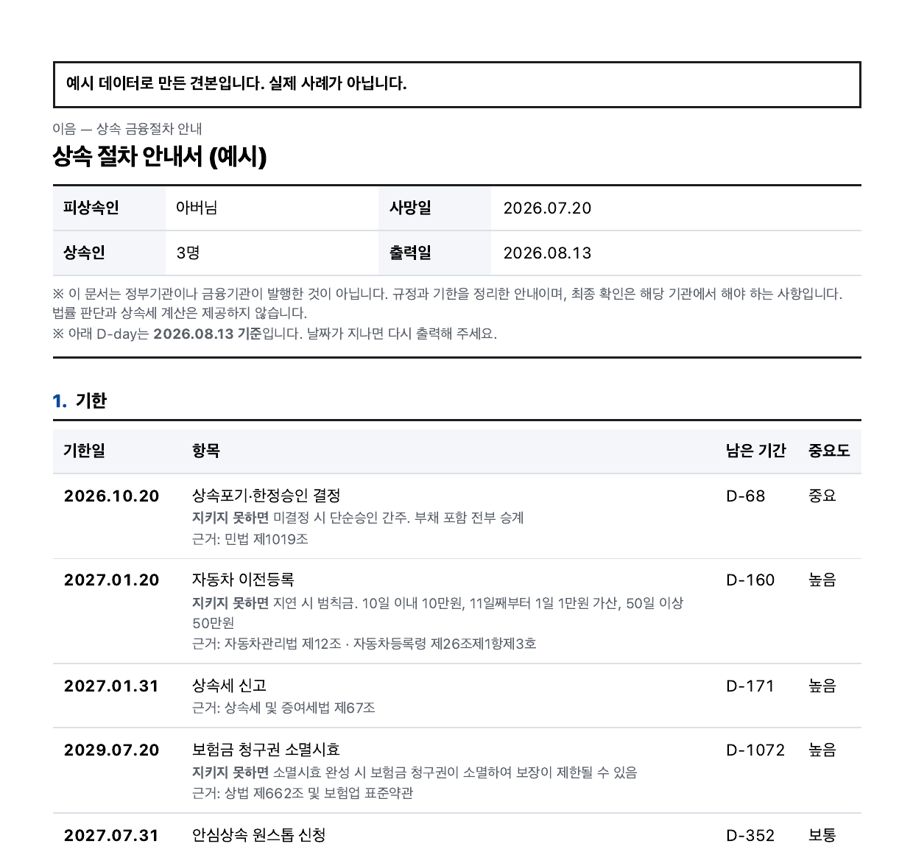

# 이음 (EUM)

> 상속인이 3개월 안에 끝내야 하는 금융 절차를 기한과 서류 단위로 관리하는 웹서비스

금융보안원 주최 2026 금융 AI Challenge 출품작.

**[ieumnavi.com](https://ieumnavi.com)** · 회원가입 없이 바로 쓸 수 있습니다.



## 왜 만들었나

상속세를 내는 사람은 전체 사망자의 6%입니다. 이들에게는 세무사와 변호사가 붙습니다.
나머지 94%는 수임료가 발생하지 않아 시장이 형성되지 않은 구간이고, 그래서 아무도
도와주지 않습니다. 하지만 절차의 복잡성은 재산 규모와 무관합니다. 3천만 원을 상속받는
사람도 은행 열 곳을 똑같이 돌아야 하고, 3개월 기한을 똑같이 지켜야 합니다.

정부 서비스는 "찾기"에서 끝납니다. 금감원 상속인 금융거래 조회와 안심상속 원스톱서비스는
재산이 어디에 있는지 알려준 뒤 "상세 거래내역, 잔액 등은 해당 금융회사에 직접 방문하여
확인하셔야 합니다"로 안내를 마칩니다. 기관명과 금액이 적힌 목록을 받아 들고, 그래서 뭘
언제까지 해야 하는지는 상속인이 알아서 알아내야 합니다.

제도에는 시간 함정이 있습니다. 상속포기·한정승인은 상속 개시를 안 날로부터 3개월 안에
결정해야 하는데, 빚이 얼마인지 확인하는 금융재산 조회에만 최대 20영업일이 걸립니다.
조회 결과는 접수일로부터 3개월이 지나면 삭제되고, 기한을 넘기면 단순승인으로 간주되어
부채까지 전부 승계됩니다. 정부 조회 서비스는 이 기한을 알려주지 않습니다.

## 무엇을 하나

이음은 조회 이후 구간을 맡습니다. 사망일을 넣으면 흩어진 기한이 전부 D-day로 바뀌고,
상속인 구성에서 법정상속분이 나오고, 기관별로 어떤 서류를 몇 통 준비해야 하는지가
한 장으로 정리됩니다. 기한이 다가오면 메일이 먼저 가고, 영업점에 들고 갈 안내서는
종이로 출력됩니다.

챗봇이 아니라 대시보드입니다. 상속에서 사람이 실패하는 건 답을 못 들어서가 아니라
물어볼 생각을 못 해서입니다. 그래서 사용자가 묻기를 기다리지 않고, 규정과 상황을
대조해 해당되는데 아직 하지 않은 것을 먼저 꺼내 보여줍니다.

법률 판단은 하지 않습니다. 한정승인을 검토해야 하는 상황이면 그 사실과 기한을 알리고
전문가 상담으로 연결하는 데서 정확히 멈춥니다. 상속세도 계산하지 않고 신고 기한만
알립니다.

## 기능

**기한 관제** — 사망일 하나로 상속포기·상속세·취득세·자동차 이전등록 등 기한 7종을 D-day로
환산합니다. 중요도가 높은 순으로 세우고, 지키지 못하면 어떻게 되는지를 함께 적습니다.



**기관별 실행 계획** — 기관마다 다른 필요 서류와 방문 범위를 정리하고, 전체를 합산해
주민센터에서 한 번에 뗄 목록을 만듭니다. 소액 간소화로 혼자 가도 되는 기관과 전원이
가야 하는 기관이 갈립니다.



**누락 탐지** — 규정과 상황을 대조해 해당되는데 아직 안 한 항목을 찾습니다. 규정 원문을
그대로 싣고, 그 옆에 AI가 쉬운 말로 풀어 붙입니다. 항목과 기한과 출처는 규칙 엔진이
계산한 값입니다.



**알림과 안내서** — 기한 30·14·7·3·1일 전에 메일이 갑니다. 영업점에 들고 갈 안내서는
체크 칸과 절대 날짜, 출처를 담아 종이로 출력됩니다.

<p align="center">
  
  
</p>

그 밖에 가족관계증명서·조회 결과 이미지에서 상속인 구성과 재산을 읽는 문서 판독,
법정상속분 계산(대습상속 포함)이 있습니다.

## 설계

기한과 법정상속분은 LLM이 계산하지 않습니다. 날짜를 틀리면 회복이 안 되기 때문에
`lib/engines/`의 순수 함수로만 처리하고, 이 디렉터리가 `lib/llm/`을 import하지 않는지
테스트로 검사합니다. LLM은 문서 판독과 문장 다듬기에만 씁니다.

누락 탐지는 세 단계를 고정 순서로 거칩니다.

```
규칙 필터(결정론) → LLM 재평가 → guard 필터 → 화면
```

LLM은 후보를 새로 만들 수 없고, 관련 없다고 해도 항목을 지우지 못합니다. guard에 걸린
문장은 결정론 문안으로 되돌아갑니다. 판단·권유 표현, 상속세 세액 서술, 출처 없는 항목이
걸러집니다.

LLM이 실패해도 서비스는 멈추지 않습니다. 문서 판독 실패는 수동 입력 폼으로, 재평가 실패는
규칙 필터 결과로 내려앉습니다.

개인정보는 저장하지 않습니다. 이름은 입력 즉시 마스킹하고 주민등록번호·생년월일은 받지
않습니다. 업로드 이미지는 파싱 직후 버리고, 케이스는 브라우저 세션에만 둡니다. 서버에
남는 건 동의한 알림 구독 9개 필드뿐입니다.

## 검증

| 지표 | 목표 | 결과 |
|---|---|---|
| 누락 탐지 재현율 (규칙 필터) | 85% ↑ | 100% — 정답 102건 / 시나리오 35건 |
| 오탐율 | 15% ↓ | 0% |
| guard 차단율 (LLM 문장) | — | 15.5% — 97건 중 15건 |
| 금지 표현 노출 | 0건 | 0건 |
| 문서 파싱 정확도 | 90% ↑ | 100% — 정답 24항목 / 문서 4건 |
| 유닛테스트 | — | 563건 통과 |

정답지는 모델 출력을 옮기지 않고 규정 문서를 읽어 손으로 썼습니다.
측정 방법은 [검증결과](docs/05_검증결과.md)에 있습니다.

## 스택

Next.js 16 (App Router) · React 19 · TypeScript · Tailwind CSS 4 · Vitest ·
Claude API (`claude-opus-5`, vision) · Supabase · Resend · Vercel

```
app/            화면과 API 라우트
lib/engines/    규칙 엔진 — 기한 · 상속분 · 소액 간소화 · 시간 함정
lib/llm/        parse · detect · guard
lib/rules/      규정 DB 로더
lib/notify/     알림 일정 · 발송 · 구독
data/           규정 JSON (기관 6종 + 금감원 표준), 기한, 공휴일
tests/          563건
```

## 규정 데이터

| 기관 | 검증 수준 |
|---|---|
| KB국민 · 하나 · 신한 · 유안타증권 · 삼성생명 | `call_verified` — 원문 확보 + 고객센터 통화 확인 |
| 카카오뱅크 | `source_confirmed` — 기관 정책상 통화 불가, 데모 제외 |
| 금감원 공통 표준 | `source_confirmed` — 공식 서식 원문 확보 |

확인하지 못한 값은 다른 기관 값으로 채우지 않고 `verified: false`로 남깁니다. 모든 안내에
출처 기관과 확인일자를 붙입니다. 갱신은 `data/` 파일 교체로만 합니다.

## 문서

[기획서](docs/01_기획서.md) · [개발설계서](docs/02_개발설계서.md) ·
[규정데이터 수집결과](docs/04_규정데이터_수집결과.md) · [검증결과](docs/05_검증결과.md) ·
[개발 규칙](CLAUDE.md)

## 면책

법률·세무 자문을 제공하지 않습니다. 기한과 서류 요건을 사실로 전달하고, 판단이 필요한
지점에서는 전문가 상담으로 연결합니다. 규정은 변경될 수 있으므로 최종 확인은 해당 기관에서
해야 합니다.
